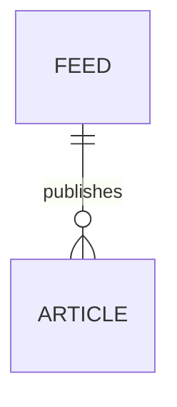

# Entity Model

## Entity Relationship Diagram

### FEED

A news feed the Reader is subscribed to, with what the last refresh learned about it.

| Attribute     | Description                                                                                          | Data Type | Length/Precision | Validation Rules         |
|---------------|------------------------------------------------------------------------------------------------------|-----------|------------------|--------------------------|
| id            | Unique identifier, a generated UUID of 36 characters                                                 | String    | 36               | Primary Key              |
| title         | Display title as plain text; from the feed or the import file, else the host name of the feed address | String    | 200              | Not Null                 |
| url           | Address the feed is retrieved from                                                                   | String    | -                | Not Null, Unique, Format: URL |
| site_url      | Address of the website the feed belongs to                                                           | String    | -                | Optional, Format: URL    |
| etag          | Version tag the Feed Publisher gave the last downloaded version, sent back to skip unchanged feeds   | String    | -                | Optional                 |
| last_modified | Modification date the Feed Publisher gave the last downloaded version, kept as received text          | String    | -                | Optional                 |
| last_error    | Problem of the latest failed refresh; empty after a successful one                                   | String    | -                | Optional                 |

### ARTICLE

A single item of a feed, with the Reader's read and starred state.

| Attribute    | Description                                                                                   | Data Type | Length/Precision | Validation Rules              |
|--------------|-----------------------------------------------------------------------------------------------|-----------|------------------|-------------------------------|
| id           | Identifier made of the feed id and the item's identifier, link, or title                      | String    | -                | Primary Key                   |
| feed_id      | Feed that published the article                                                               | String    | 36               | Not Null, Foreign Key (FEED.id) |
| title        | Title as plain text, at most 500 characters; "(Untitled)" when the item has none              | String    | -                | Not Null                      |
| link         | Address of the article's web page                                                             | String    | -                | Optional, Format: URL         |
| author       | Name of the author                                                                            | String    | -                | Optional                      |
| content_html | Formatted content shown in the article view; empty when the item has no content or summary    | String    | -                | Not Null                      |
| snippet      | Plain-text excerpt shown in the article list, at most 280 characters                          | String    | -                | Not Null                      |
| published    | Publication date given by the feed                                                            | DateTime  | -                | Optional                      |
| fetched      | Time the article was first stored; orders undated articles and drives expiry                  | DateTime  | -                | Not Null                      |
| is_read      | Whether the Reader has read the article; false for a new article                              | Boolean   | -                | Not Null                      |
| is_starred   | Whether the Reader has starred the article; false for a new article                           | Boolean   | -                | Not Null                      |

#### Constraints

- Removing a FEED removes all of its ARTICLE rows, starred ones included (UC-002 BR-001).
- A read, unstarred ARTICLE first fetched more than 30 days ago is removed once it no longer appears in its feed (UC-003 BR-008).
- The library is stored as one JSON document in the app's sandbox container; the model above describes its logical structure.
